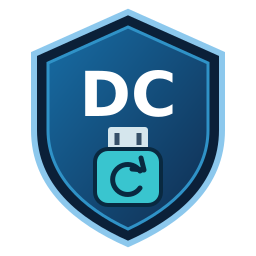
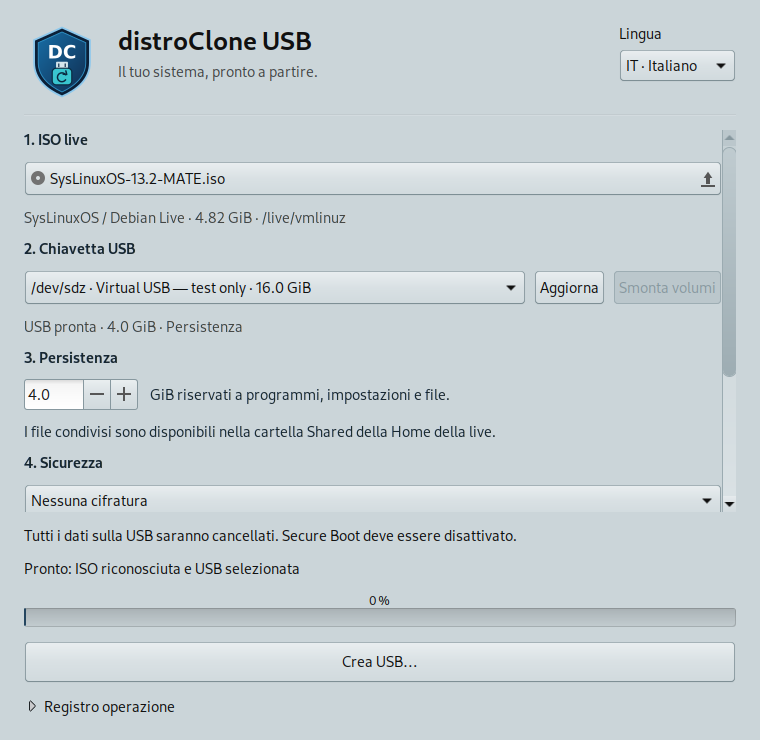

# DistroClone USB

<p align="center">
  
</p>

[](https://github.com/fconidi/distroClone-usb/releases/latest)
[](LICENSE)

Create a persistent live USB from a Debian Live, SysLinuxOS, Ubuntu or Linux Mint
desktop ISO. Companion to **distroClone** (ISO creation) and
**distroclone-backup** (backup and recovery).



## Install and run

Download the Debian package from the [latest release](https://github.com/fconidi/distroClone-usb/releases/latest), then install it:

```bash
sudo apt install ./distroclone-usb_0.3.1_all.deb
distroclone-usb
```

To build from source, run `bash build-deb.sh`; the package is generated in `dist/`.

Choose an ISO, select a USB drive, set persistence space in GiB and choose an encryption mode, then click
**Create USB**. Check the disk model, capacity and serial number, type its device
name and authenticate. **All existing data on that drive is erased.**
Mounted desktop volumes can be unmounted with the dedicated button. Other mounts,
swap, internal drives and disks used by device-mapper/RAID are rejected. The
backend also refuses the disk containing the source ISO. The desktop runs as your
normal user; only the fixed writer helper runs as administrator.


The boot menu provides persistent, temporary and safe-graphics sessions.
Changes to applications, settings and files persist; a live USB is not a full
installation, and kernel/initramfs upgrades are not guaranteed to take effect.
The tool creates an **unsigned x86-64 UEFI** loader and a **Legacy BIOS** loader.
**Disable Secure Boot** to use the generated USB. See
[compatibility](docs/COMPATIBILITY.md) for implemented and verified combinations.

On SysLinuxOS, launch it from **SysLinuxOS Tools → DistroClone USB**.

## Shared files and optional encryption

New USBs expose **Shared** in the live user's home and at `/Shared`. Copy portable
files into `Shared` on the persistence volume from another Linux system.
Choose no encryption, encrypted persistence/Shared, or full encryption including
the ISO. Encryption initially supports verified Debian Live / SysLinuxOS images;
casper encryption is rejected. Full encryption keeps minimal boot code readable,
uses a US boot keyboard and asks separately in GRUB and Linux. Existing USBs are
not upgraded in place. See [security and usage details](docs/ENCRYPTION.md).

## Read-only commands

```bash
distroclone-usb --inspect /path/to/live.iso
distroclone-usb --list-devices
distroclone-usb --plan /path/to/live.iso --device /dev/sdX --persistence-mib 4096
distroclone-usb --check-dependencies
```

These commands do not write media. The privileged helper additionally requires the
reviewed ISO digest, current device identity and exact device-name confirmation.
Never run the GTK desktop as root.

## Development and verification

```bash
/usr/bin/python3 -m unittest discover -s tests -v
/usr/bin/python3 -m distroclone_usb --inspect /path/to/live.iso
/usr/bin/python3 tests/gtk_workflow.py --output "$HOME/.cache/distroclone-usb/.test-artifacts/ui"
bash build-deb.sh
```


Python standard library plus GTK 3/PyGObject; no pip dependencies. The interface,
confirmation dialogs and application diagnostics support **English, Italian,
Spanish, French and German**. The initial language follows the session locale;
use the language selector to switch without losing the ISO, disk or size selection.
External command diagnostics and system authentication dialogs follow their own
locale. Set `LANGUAGE=it` (or `en`, `es`, `fr`, `de`) to select a startup language.

The original ISO is copied intact to an ext4 data partition, so ISO files larger
than 4 GiB are supported. A separate ext4 partition stores persistence. GRUB
loads the kernel/initrd from the ISO and passes the selected live profile's
parameters. The application never executes boot scripts obtained from the ISO.

The SVG logo is original artwork: the suite's blue DC shield motif combined with
a turquoise USB drive and circular persistence arrow. It scales for desktop menus
and high-resolution displays without needing bitmap regeneration.

Copyright © 2026 Franco Conidi. Code and original artwork:
**GPL-3.0-or-later**. No code was copied from mx-remaster.
